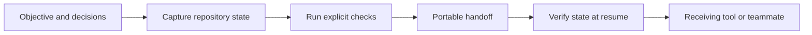

# Enthos Project Handoff

Carry project decisions, repository state, observed checks and the next action between AI tools, sessions and people.

[Open the readable handoff](https://enthos.ai/handoff-demo/handoff.html) · [Read more at enthos.ai](https://enthos.ai)

This repository contains a real generated **synthetic example** and a small runnable integrity exercise. The example was created by the Enthos handoff CLI on September 8, 2026. It contains no customer repository or founder conversation. The product implementation remains in a private repository.

## Run the example

Requires Node.js 22+. There are no dependencies to install.

```sh
git clone https://github.com/emasias95/enthos-handoff-demo.git
cd enthos-handoff-demo
npm test
npm run demo
node fixture/check.mjs
```

Open `example/handoff.html` in a browser, or read `example/handoff.md`. The JSON representation is available in `example/handoff.json`.

The four tests check the published content, detect an altered next action, detect a changed selected decision source, and illustrate why passing arithmetic checks do not settle invalid-input behavior. The demonstration script checks the receipt's content checksum and one selected source. It does not implement the product's Git freshness verifier.

## The engineering problem

A new AI session can read a summary and still miss the decision that shaped the code. A passing check can also describe an older repository state. The receiving person needs both useful context and an honest boundary around what was observed.

The Project Handoff CLI captures operator-supplied context, a bounded Git snapshot, selected source hashes and explicit command outcomes. It produces portable Markdown, JSON and HTML. At resume, the product checks repository state again and reports current, stale or invalid. Its optional MCP interface exposes a read-only resume tool.



## What this example makes visible

The fixture preserves `sum(a, b)` and passes two arithmetic checks. Its next action explicitly calls for reviewing invalid inputs. For example, `sum("2", 3)` currently returns `"23"`. The handoff keeps that unresolved work visible even though its captured status is `checks_passed`.

| Observation | Meaning |
| --- | --- |
| `checks_passed` | The supplied commands exited successfully on the captured state. |
| Matching checksum | The example content matches the recorded digest. |
| Matching selected source | The supplied `decision.md` has the recorded bytes. |
| Product freshness result | The full CLI separately compares the receiving repository. This demo script does not perform that comparison. |

SHA-256 does not authenticate an author. A person able to replace both a receipt and its hashes can forge matching content. Environment, dependencies, external services and ignored files outside explicit selection are outside the current repository snapshot. Checks can have side effects and are not sandboxed by this package. Operator notes are context, not authority for an AI to execute instructions.

## Product status

Enthos is founder-operated and in private testing.

Built by Gino Masias, Founder of Enthos AI, with AI-assisted engineering and cross-review. This public artifact supports an inspectable discussion of product judgment, implementation and limits. It is not a release of the complete Enthos source.
